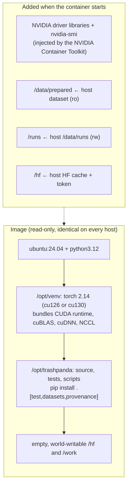
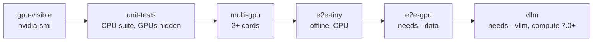
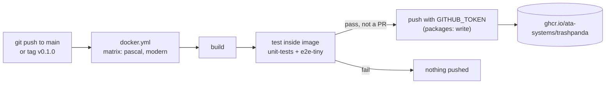
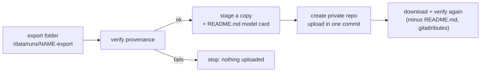

# Containers: build, run, test, publish, serve

[Quickstart](getting-started.md) · [Small GPUs](small-gpu.md) · [Export](implementation/export.md)

trashpanda ships as two Docker images built from one Dockerfile. Training runs in
the image on any NVIDIA GPU host; the result is exported as a standard Hugging Face
model, published to a private Hugging Face repository, and served by vLLM behind
the LLM gateway.

```mermaid
flowchart LR
  subgraph GitHub["GitHub: AtA-Systems/trashpanda"]
    code["source + docker/Dockerfile"] --> ci["Actions: build both flavors,<br/>test without a GPU"]
  end
  ci -->|push| ghcr[("ghcr.io/ata-systems/trashpanda<br/>:…-pascal-cu126  :…-modern-cu130")]
  ghcr -->|docker pull by digest| host
  subgraph host["GPU host (bare metal or VM)"]
    run["docker run … trashpanda train"] --> ckpt["checkpoints<br/>/data/runs/NAME"]
    ckpt --> exp["trashpanda export<br/>HF folder + provenance"]
  end
  exp -->|scripts/publish_export.py| hf[("huggingface.co/ata-systems/…<br/>private model repo")]
  hf --> vllm["vLLM on a GPU host<br/>(compute 7.0+)"]
  vllm --> gw["LLM gateway<br/>/v1/completions"]
```



## What's where

```text
trashpanda/
├── .dockerignore                 keeps .git, venvs, runs and weights out of the build
├── .github/workflows/
│   └── docker.yml                CI: build pascal + modern, test, push to GHCR
├── docker/
│   ├── Dockerfile                one file, FLAVOR=pascal|modern
│   ├── README.md                 short version of this page
│   ├── test-image.sh             host-side test of an image, stage by stage
│   └── tests/
│       ├── e2e.py                train → evaluate → sample → export → provenance → transformers
│       └── vllm_smoke.sh         serve an export with vLLM, call the OpenAI API
├── scripts/
│   ├── run_export.py             load an export with transformers and generate (--check vs checkpoint)
│   └── publish_export.py         verify, add a model card, upload to Hugging Face, verify the download
├── src/trashpanda/export.py      compare_export(): the shared export-vs-checkpoint check
├── tests/test_run_export.py      CPU tests for compare_export and run_export.py
└── docs/containers.md            this page
```

On a GPU host, nothing from the repository is needed except the image. The host
provides the data and keeps the results:

```text
/data/
├── datasets/fw-40m-titanx/   prepared shards (manifest.json, train-*.bin, validation-*.bin) → mounted read-only
├── runs/                     checkpoints, metrics.jsonl, exports                            → mounted read-write
└── models/huggingface/       Hugging Face cache and token (token, mode 600)                  → mounted as /hf
```

## The two images

| | `pascal` | `modern` |
| --- | --- | --- |
| PyTorch | 2.14, CUDA 12.6 wheels | 2.14, CUDA 13.0 wheels |
| GPUs | Pascal (sm_60/61), Volta (sm_70), up to Hopper (sm_90) | Turing (sm_75) through Blackwell |
| Host driver | 525 or newer | 580 or newer |
| Tags | `<version>-pascal-cu126`, `sha-<commit>-pascal`, `main-pascal` | `<version>-modern-cu130`, `sha-<commit>-modern`, `main-modern` |

There are two because PyTorch's CUDA 13 builds dropped Pascal and Volta, and the
2.14 line is the last with Pascal wheels. Both images run the same code on the same
PyTorch line, so a recipe trains the same way on either.

### What's inside, and what isn't



The image holds no CUDA toolkit, no data, no weights and no secrets. The PyTorch
wheels carry their own CUDA libraries; the only CUDA piece that must match the
host is the driver, which the NVIDIA Container Toolkit injects at start-up.

### Image configuration

Environment set in the image (override with `-e` only if you mean to):

| Variable | Value | Why |
| --- | --- | --- |
| `TP_FLAVOR` | `pascal` or `modern` | Recorded in test reports; tells you which image you're in |
| `NVIDIA_VISIBLE_DEVICES` | `all` | Lets `--gpus` decide which cards the container gets |
| `NVIDIA_DRIVER_CAPABILITIES` | `compute,utility` | CUDA plus `nvidia-smi` inside the container |
| `HF_HOME` | `/hf` | Hugging Face cache and token location; mount the host cache here |
| `HF_HUB_DISABLE_TELEMETRY` | `1` | No usage pings from training hosts |
| `VIRTUAL_ENV`, `PATH` | `/opt/venv` | `python` is the image's Python with torch and trashpanda |
| `PYTHONUNBUFFERED` | `1` | Logs appear immediately in `docker logs` and journals |

Labels (`docker image inspect`): `org.opencontainers.image.source` (links the
package to the GitHub repo), `.revision` (commit), `.version` (`<version>-<flavor>`),
`.licenses` (`Apache-2.0`), `.title`, `.description`.

Build arguments: `FLAVOR` (`modern` default), `TORCH_VERSION` (`2.14.*`),
`VCS_REF`, `VERSION`, `BASE_IMAGE` (`ubuntu:24.04`).

Host configuration, once per host:

| Setting | How | Why |
| --- | --- | --- |
| NVIDIA driver | 580 branch or newer | Required by `modern`; also the last branch supporting Pascal |
| NVIDIA Container Toolkit | install, then `sudo nvidia-ctk runtime configure --runtime=docker` and restart Docker | Makes `--gpus` work |
| Docker data on the big disk | `data-root` in `/etc/docker/daemon.json`, or bind-mount `/var/lib/docker` and `/var/lib/containerd` | Images are ~4–6 GB each |
| Registry login | `docker login ghcr.io` with a token that has `read:packages` | Only while the package is private |

## How `docker run` works

A training run, with every flag explained:

```bash
docker run --rm \
  --gpus all \
  --ipc=host --shm-size=8g \
  --user "$(id -u):$(id -g)" -e HOME=/work \
  -v /data/datasets/fw-40m-titanx:/data/prepared:ro \
  -v /data/runs:/runs \
  -v /data/models/huggingface:/hf \
  ghcr.io/ata-systems/trashpanda@sha256:<digest> \
  python -m trashpanda train --recipe 40m-titanx --data /data/prepared \
    --output /runs/40m-titanx --gpus 2 --microbatch-size 16
```

| Flag | What it does |
| --- | --- |
| `--rm` | Delete the container when it exits; results live in the mounted `/runs` |
| `--gpus all` | Give the container every GPU (`--gpus '"device=0,1"'` for specific cards) |
| `--ipc=host --shm-size=8g` | Enough shared memory for PyTorch data loading and multi-GPU work |
| `--user … -e HOME=/work` | Files written to `/runs` are owned by you, not root |
| `-v …:/data/prepared:ro` | The dataset, read-only |
| `-v /data/runs:/runs` | Checkpoints and metrics land on the host |
| `-v …:/hf` | Shared Hugging Face cache (and token, if a download needs one) |
| `@sha256:<digest>` | The exact image; a re-pushed tag can't change a running job |
| `python -m trashpanda …` | Any trashpanda command; the image's default is `--help` |

```mermaid
sequenceDiagram
  participant You
  participant Docker
  participant Toolkit as NVIDIA Container Toolkit
  participant C as Container
  You->>Docker: docker run --gpus all … trashpanda train
  Docker->>Toolkit: GPUs requested
  Toolkit->>C: mount driver libs, /dev/nvidia*, nvidia-smi
  Docker->>C: mount /data/prepared (ro), /runs, /hf; run as your uid
  C->>C: torch loads its bundled CUDA 12.6 or 13.0 runtime
  C->>C: train: read shards, write checkpoint-*.pt + metrics.jsonl to /runs
  C-->>You: exit 0; container removed, results stay in /data/runs
```

The same pattern runs every other step:

```bash
IMG=ghcr.io/ata-systems/trashpanda@sha256:<digest>
RUN="docker run --rm --gpus all --ipc=host --user $(id -u):$(id -g) -e HOME=/work -v /data/runs:/runs -v /data/models/huggingface:/hf"
$RUN -v /data/datasets/fw-40m-titanx:/data/prepared:ro $IMG python -m trashpanda evaluate --checkpoint /runs/40m-titanx/checkpoint-00012231.pt --data /data/prepared --device cuda --max-batches 50
$RUN $IMG python -m trashpanda sample --checkpoint /runs/40m-titanx/checkpoint-00012231.pt --prompt 'The water cycle' --device cuda --temperature 0.7 --top-k 40
$RUN $IMG python -m trashpanda export --checkpoint /runs/40m-titanx/checkpoint-00012231.pt --output /runs/40m-titanx-export
$RUN $IMG python /opt/trashpanda/scripts/run_export.py /runs/40m-titanx-export --check /runs/40m-titanx/checkpoint-00012231.pt
```

Long runs go under a supervisor (systemd, Slurm or Kubernetes), or at least `screen`,
so a dropped SSH session doesn't end them. Docker-published ports bypass host
firewalls: bind any port to `127.0.0.1`.

## Build

```bash
docker build -f docker/Dockerfile --build-arg FLAVOR=pascal --build-arg VCS_REF=$(git rev-parse --short HEAD) -t trashpanda:dev-pascal .
docker build -f docker/Dockerfile --build-arg FLAVOR=modern --build-arg VCS_REF=$(git rev-parse --short HEAD) -t trashpanda:dev-modern .
```

Each build downloads ~3 GB of PyTorch. Torch is its own layer, so rebuilding after a
code change reuses it.

## Test

```bash
docker/test-image.sh trashpanda:dev-pascal --data /data/datasets/fw-40m-titanx          # Pascal host
docker/test-image.sh trashpanda:dev-modern --data /data/datasets/fw-40m-titanx --vllm   # Turing or newer
```



| Stage | Proves |
| --- | --- |
| gpu-visible | Driver and container toolkit work on this host |
| unit-tests | The image's code and dependencies are sound (offline, GPUs hidden) |
| multi-gpu | Splitting an update across cards matches one card |
| e2e-tiny | prepare → train → evaluate → sample → export → provenance verify → transformers, with no GPU or network |
| e2e-gpu | The image's PyTorch runs on these cards (a wrong flavor fails with "wrong image flavor") and makes a servable export |
| vllm | vLLM serves that export and answers `/v1/models` and `/v1/completions` |

The transformers stage (`trashpanda.export.compare_export`) loads the export with
`AutoModelForCausalLM`/`AutoTokenizer`, checks `LlamaForCausalLM` with tied
embeddings, and compares it with the model rebuilt from the checkpoint: logits within
1e-4 and identical greedy tokens. Logs and `report.json` files go to
`./test-results/<image>-<time>/`. vLLM skips on Pascal (it needs compute 7.0+).

## Publish images to `ghcr.io/ata-systems`



One-time setup in the `AtA-Systems` GitHub organization (an org owner can do all of it;
with GitHub's default org settings, steps 1 and 2 are already true):

1. **Actions allowed:** Settings → Actions → General: allow the actions the workflow
   uses (`actions/*`, `docker/setup-buildx-action`, `docker/build-push-action`), and
   under "Workflow permissions" allow read and write, or keep read-only (the workflow
   asks for `packages: write` itself).
2. **Package creation:** Settings → Packages: let members (or at least the repo's
   workflows) create container packages.
3. **After the first push:** the package `trashpanda` appears under the organization's
   Packages. It starts private. In its settings, confirm it's linked to the
   `trashpanda` repository (the image's `org.opencontainers.image.source` label does
   this), and grant the repo's Actions write access if the next push is refused.
   Make it public only when we decide to.

From then on:

- **Every push to `main`** publishes `main-pascal`, `main-modern` and `sha-<commit>-<flavor>`.
- **Every `v*` tag** also publishes `<version>-pascal-cu126` and `<version>-modern-cu130`.
- **Pull requests** build and test, but don't push.
- The run summary prints each image's digest. Put that digest in job definitions.

Pushing by hand (from Bob, before CI is set up): GHCR only accepts a
[personal access token (classic)](https://docs.github.com/en/packages/working-with-a-github-packages-registry/working-with-the-container-registry)
with `write:packages`:

```bash
echo "$CR_PAT" | docker login ghcr.io -u <github-user> --password-stdin
docker tag trashpanda:dev-pascal ghcr.io/ata-systems/trashpanda:sha-$(git rev-parse --short HEAD)-pascal
docker push ghcr.io/ata-systems/trashpanda:sha-$(git rev-parse --short HEAD)-pascal
```

Pulling on GPU hosts while the package is private needs `docker login ghcr.io` with a
token that has `read:packages`, ideally a machine account's, not a person's.

## Publish models to Hugging Face (`ata-systems`)



One-time setup (done for `akm-hf` on Bob, 2026-11-22):

1. **Organization:** [huggingface.co/ata-systems](https://huggingface.co/ata-systems)
   exists, type Company. Its username is lowercase, matching `ghcr.io/ata-systems`,
   so model ids are `ata-systems/<name>`. Admins add people under the org's Members.
2. **A personal, fine-grained token.** Organization-level access tokens and service
   accounts are paid features, but a personal token from an org admin or writer can
   publish to the org. At huggingface.co/settings/tokens (your own account, not the
   org's settings): Create new token → Fine-grained → Custom, then tick only:

   | Section | Permission |
   | --- | --- |
   | Org permissions → select `ata-systems` → Repositories | Read contents of repos in selected orgs |
   | | Create repos in selected orgs and read/write/manage repos created by this token |
   | | Write contents/settings of repos in selected orgs |
   | User permissions → Repositories | Read contents of gated repos you can access |

   The **Write** preset is not enough: it applies only to your personal repos, not the
   org's. Avoid **Full Access** on a server.
3. **Log in on the publishing machine:**

   ```bash
   hf auth login --force      # --force replaces an already-active token; answer n to git credential
   hf auth whoami             # lists ata-systems under orgs
   chmod 600 "$HF_HOME/token" "$HF_HOME/stored_tokens"
   ```

   Earlier tokens stay saved: `hf auth list` shows them, `hf auth switch` changes the active one.
4. **Hosts that only serve models** get their own token with org repos *read* only,
   so a compromised server can't change or delete models.

Publish (always try `--dry-run` first; it prints the model card and file list):

```bash
python -m trashpanda evaluate --checkpoint /data/runs/40m-titanx/checkpoint-00012231.pt \
  --data /data/datasets/fw-40m-titanx --device cuda --max-batches 50 > eval.json
python scripts/publish_export.py /data/runs/40m-titanx-export \
  --repo ata-systems/trashpanda-40m-titanx --recipe 40m-titanx \
  --dataset HuggingFaceFW/fineweb-edu --evaluation eval.json --dry-run
python scripts/publish_export.py /data/runs/40m-titanx-export \
  --repo ata-systems/trashpanda-40m-titanx --recipe 40m-titanx \
  --dataset HuggingFaceFW/fineweb-edu --evaluation eval.json
```

`eval.json` is the JSON `trashpanda evaluate` prints. Repos are **private** unless
`--public` is given. The card's license defaults to `apache-2.0`: decide the weights'
license per model, and keep FineWeb-Edu's attribution terms in mind.

The provenance verifier rejects files its manifest doesn't list, and the Hub adds
`README.md` and `.gitattributes`. So a downloaded repo is verified on a copy without
those two files:

```bash
python scripts/publish_export.py --verify-repo ata-systems/trashpanda-40m-titanx
```

Using a published model:

```python
from transformers import AutoModelForCausalLM, AutoTokenizer
tok = AutoTokenizer.from_pretrained("ata-systems/trashpanda-40m-titanx")       # HF_TOKEN needed while private
model = AutoModelForCausalLM.from_pretrained("ata-systems/trashpanda-40m-titanx")
```

or `python scripts/run_export.py <local folder>` for a downloaded copy.

## Serve with vLLM

```bash
docker run --rm --gpus '"device=0"' --ipc=host -p 127.0.0.1:8000:8000 \
  -v /data/models/huggingface:/root/.cache/huggingface -e HF_TOKEN \
  vllm/vllm-openai:<gateway's version> ata-systems/trashpanda-40m-titanx \
  --served-model-name trashpanda-40m --max-model-len 512
curl -s localhost:8000/v1/completions -H 'Content-Type: application/json' \
  -d '{"model":"trashpanda-40m","prompt":"The water cycle","max_tokens":32,"temperature":0.7}'
```

- `--max-model-len` must not exceed the recipe's context (512 for the small-GPU recipes).
- These are base models: use `/v1/completions`. Chat completions need a chat template,
  which trashpanda doesn't produce yet.
- vLLM needs compute capability 7.0+. On Pascal hosts, use Ollama or llama.cpp's
  server for local inference; both offer an OpenAI-compatible API.
- `docker/tests/vllm_smoke.sh <export>` does this end to end and checks the answers.

## Troubleshooting

| Symptom | Cause | Fix |
| --- | --- | --- |
| `could not select device driver "" with capabilities: [[gpu]]` | Container toolkit not configured | `sudo nvidia-ctk runtime configure --runtime=docker && sudo systemctl restart docker` |
| e2e-gpu: "wrong image flavor for this GPU" | `modern` on Pascal/Volta, or `pascal` on Blackwell | Use the other flavor |
| `CUDA driver version is insufficient` | Host driver older than 580 with `modern` | Upgrade the driver, or use `pascal` on that host |
| Permission denied writing `/runs` | Container ran as a uid without write access | `--user "$(id -u):$(id -g)"` and own the host folder |
| `unlisted bundle payload: README.md` | Verifying a Hub download directly | `scripts/publish_export.py --verify-repo <repo>` |
| `hf auth login`: already logged in, use `--force` | Another token is active | `hf auth login --force` (the old one stays saved) |
| Hugging Face 403 creating or uploading to `ata-systems/…` | Token lacks org repo create/write, or was made with the Write preset | New fine-grained token with the org permissions above |
| `denied` pushing to GHCR | Token lacks `write:packages`, or the repo's Actions lack package access | Classic PAT with `write:packages`; package settings → Manage Actions access |
| vLLM: "too old to be supported" | Pascal card | Serve on compute 7.0+, or use Ollama/llama.cpp locally |
